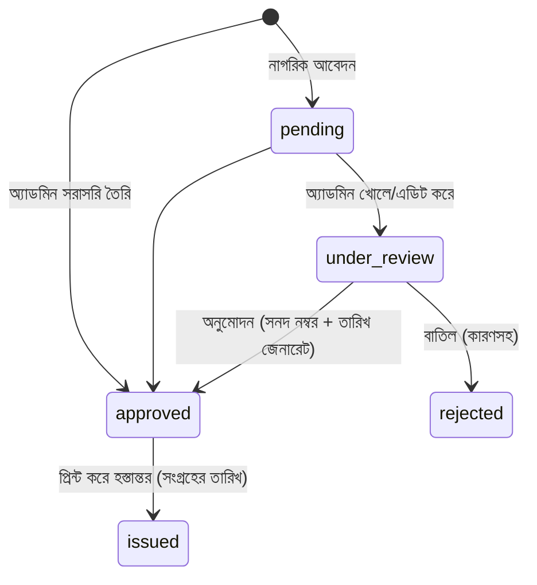

# প্রত্যয়ন ম্যানেজমেন্ট সিস্টেম — প্ল্যান (Handoff-ready)

> এই ফাইলটিই প্রজেক্টের "single source of truth"। যেকোনো মডেল/এজেন্ট কাজ শুরুর আগে এটি এবং `PROGRESS.md` পড়বে, কাজ শেষে `PROGRESS.md` আপডেট করবে।

## ১. বিদ্যমান প্রজেক্টের কনভেনশন (অবশ্যই অনুসরণীয়)
- Laravel 11, PHP ^8.2, MySQL, Breeze auth, Tailwind + Vite, Blade views। UI ভাষা: বাংলা।
- Routes: `routes/front.php` (পাবলিক), `routes/dashboard.php` (অ্যাডমিন, `auth` middleware, prefix `dashboard`)। `bootstrap/app.php` থেকে লোড হয়।
- Admin controllers: `app/Http/Controllers/dash/`; Front: `app/Http/Controllers/front/`।
- Views: `resources/views/dashboard/<module>/`, `resources/views/front-views/`; Layout: `layouts/`, dashboard layout `dashboard/dashboard.blade.php`।
- Models: `app/Models/<module>/XxxModel.php` ধাঁচে। `users` টেবিলে এখন শুধু অ্যাডমিন (role নেই)।
- নতুন সিস্টেম আলাদা নামস্থানে: `App\...\Attestation`, route name prefix `attestation.*`, view folder `attestation/`। বিদ্যমান ফাইল ন্যূনতম বদল (শুধু route include + সাইডবার মেনু লিংক)।

## ২. রোল ও ফ্লো
| রোল | কী করতে পারবে |
|---|---|
| **অ্যাডমিন** (লগইনকৃত) | প্রত্যয়নের ধরন/টেমপ্লেট ম্যানেজ; সরাসরি প্রত্যয়ন তৈরি; আবেদন দেখা/**এডিট**/অনুমোদন/বাতিল; প্রিন্ট/PDF; রেজিস্টার/রিপোর্ট |
| **নাগরিক** (পাবলিক) | ধরন বেছে অনলাইনে আবেদন; ট্র্যাকিং নম্বর দিয়ে স্ট্যাটাস দেখা। **প্রত্যয়ন অনলাইনে ডাউনলোড নয়** — অনুমোদনের পর পৌরসভায় গিয়ে সংগ্রহ (হার্ডকপি) |



## ৩. আর্কিটেকচার সিদ্ধান্ত (মূল কৌশল)
প্রতিটি নমুনার জন্য আলাদা কোড/ভিউ **না** — একটি **ডাইনামিক টেমপ্লেট ইঞ্জিন**:
- `attestation_types` টেবিলে প্রতি ধরনের: নাম, slug, `fields` (JSON — ফর্মের ফিল্ড ডেফিনিশন: key, label_bn, type[text/textarea/date/number/select/file], required), `body_template` (বাংলা টেক্সট, `{{placeholder}}` সহ), ফি, সক্রিয়/নিষ্ক্রিয়।
- নমুনা যোগ = ডাটাবেসে/সিডারে একটি রেকর্ড; অ্যাডমিন UI থেকেও নতুন ধরন বানানো যাবে।
- একটি কমন প্রিন্ট লেআউট (পৌরসভার লোগো, হেডার, সনদ নম্বর, তারিখ, স্বাক্ষর/সিল, ঐচ্ছিক QR যাচাই) — A4, `@media print` CSS। নমুনা ভিন্ন হলে type-এ `print_layout` (blade partial নাম) দিয়ে override।
- প্রিন্ট প্রথমে ব্রাউজার প্রিন্ট (বাংলা ফন্ট সমস্যা এড়াতে, কোনো নতুন প্যাকেজ নয়)। PDF পরবর্তী ধাপে ঐচ্ছিক।

## ৪. ডাটাবেস (migrations)
- `attestation_types`: id, name, slug (unique), description, fields (json), body_template (longText), print_layout (nullable), fee (decimal), is_active, order, timestamps
- `attestation_applications`: id, tracking_no (unique), attestation_type_id (FK), applicant_name, father_name, mother_name, nid, birth_reg_no, mobile, email?, address fields (village/ward/union/upazila/district), data (json — ডাইনামিক ফিল্ড মান), attachments (json), status (enum: pending, under_review, approved, rejected, issued), reject_reason, created_by (nullable user FK; null = পাবলিক), reviewed_by, reviewed_at, timestamps, softDeletes
- `attestations` (ইস্যুকৃত সনদ): id, application_id (nullable FK — সরাসরি তৈরিতে null), attestation_type_id, certificate_no (unique, ফরম্যাট `{TYPE}-{YEAR}-{SEQ}`), issue_date, rendered_data (json snapshot — পরে টেমপ্লেট বদলালেও পুরনো সনদ অপরিবর্তিত), verification_code, issued_by, printed_count, last_printed_at, timestamps, softDeletes
- `attestation_logs`: audit trail (কে কী কখন বদলাল) — এডিট/অনুমোদন/প্রিন্ট

## ৫. ফোল্ডার স্ট্রাকচার
```
app/Models/Attestation/{AttestationType,AttestationApplication,Attestation,AttestationLog}.php
app/Services/Attestation/{TemplateRenderer,CertificateNumberGenerator,ApplicationWorkflow}.php
app/Http/Controllers/dash/Attestation/{TypeController,ApplicationController,CertificateController,ReportController}.php
app/Http/Controllers/front/AttestationApplyController.php
app/Http/Requests/Attestation/*
database/migrations/2026_11_xx_*_attestation_*.php
database/seeders/AttestationTypeSeeder.php   # নমুনা থেকে
routes/attestation.php                       # dashboard.php ও front.php থেকে require
resources/views/dashboard/attestation/{types,applications,certificates,reports}/
resources/views/attestation/{apply,track}.blade.php, print/{layout,default}.blade.php
tests/Feature/Attestation/*
docs/attestation/{PLAN.md,PROGRESS.md,SAMPLES.md}
```

## ৬. রাউট (সংক্ষেপে)
- পাবলিক: `GET /attestation` (ধরন তালিকা), `GET/POST /attestation/apply/{slug}`, `GET/POST /attestation/track` (ট্র্যাকিং নং + মোবাইল), `GET /attestation/verify/{code}`
- অ্যাডমিন (`dashboard/attestation/...`): types CRUD; applications index/show/edit/update/approve/reject/destroy; certificates index/create(সরাসরি)/show/edit/print/reprint; reports
- পাবলিক ফর্মে rate-limit (`throttle`) + honeypot/captcha; ফাইল আপলোড validation।

## ৭. ধাপ (Phases) — প্রতিটি স্বাধীনভাবে শেষ ও টেস্টযোগ্য
1. **নমুনা বিশ্লেষণ**: `SAMPLES.md`-এ প্রতিটি নমুনার ফিল্ড/টেক্সট তালিকা (ইনপুট দরকার — নিচে প্রশ্ন দেখুন)
2. **Foundation**: migrations, models, enum/status, seeder স্কেলেটন, সাইডবার মেনু
3. **টাইপ ম্যানেজমেন্ট** (অ্যাডমিন): CRUD, ফিল্ড বিল্ডার, টেমপ্লেট প্রিভিউ
4. **সরাসরি প্রত্যয়ন তৈরি + প্রিন্ট**: ডাইনামিক ফর্ম, সনদ নম্বর, প্রিন্ট লেআউট, পুনঃপ্রিন্ট কাউন্টার
5. **নাগরিক আবেদন**: পাবলিক ফর্ম, ট্র্যাকিং, নোটিফিকেশন পেজ ("পৌরসভায় এসে সংগ্রহ করুন")
6. **অ্যাডমিন আবেদন ম্যানেজমেন্ট**: তালিকা/ফিল্টার/সার্চ, এডিট, অনুমোদন→সনদ জেনারেট, বাতিল, লগ
7. **রিপোর্ট/রেজিস্টার**: তারিখ/ধরন/ওয়ার্ডভিত্তিক, CSV এক্সপোর্ট; QR যাচাই
8. **টেস্ট ও পলিশ**: Feature tests, authorization, বাংলা সংখ্যা/তারিখ হেল্পার, রেসপন্সিভ

## ৮. মডেল-শিফট নিরাপত্তা নিয়ম
- সব সিদ্ধান্ত এই ফাইলে; অগ্রগতি `PROGRESS.md`-এ চেকলিস্টে (`[ ]`/`[x]`) + "পরের ধাপ" + খোলা সমস্যা।
- প্রতি ধাপ শেষে `php artisan test` ও `php artisan route:list --name=attestation` চালিয়ে ফল PROGRESS-এ লেখা; ছোট ছোট git commit (`attestation: phase N ...`)।
- বিদ্যমান ফাইলে বদল হলে PROGRESS-এ ফাইলের নাম লেখা।
- নতুন প্যাকেজ যোগ করলে কারণসহ PROGRESS-এ লেখা।

## ৯. ঝুঁকি/নোট
- বাংলা ফন্ট প্রিন্টে: ওয়েব ফন্ট (যেমন SolaimanLipi/Noto Sans Bengali) লোকাল হোস্ট করা।
- সনদ নম্বর concurrency-safe (DB transaction + lock)।
- NID/জন্মনিবন্ধন সংবেদনশীল তথ্য — অ্যাডমিন ছাড়া প্রদর্শন নয়, লগ-এ মাস্ক।
- বিদ্যমান কোডে `SHOW TABLE STATUS` ধাঁচের হ্যাক কপি করব না; `Str::random`/ট্রানজ্যাকশন ব্যবহার।
